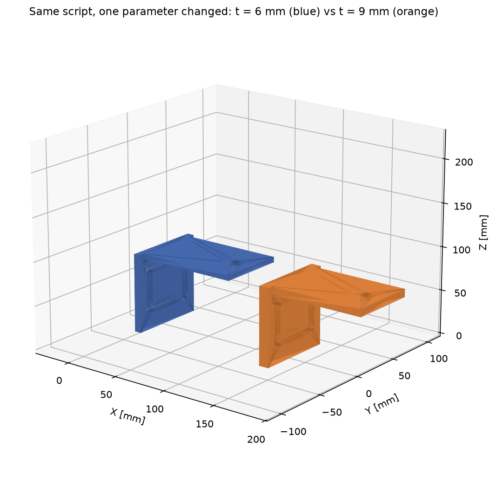
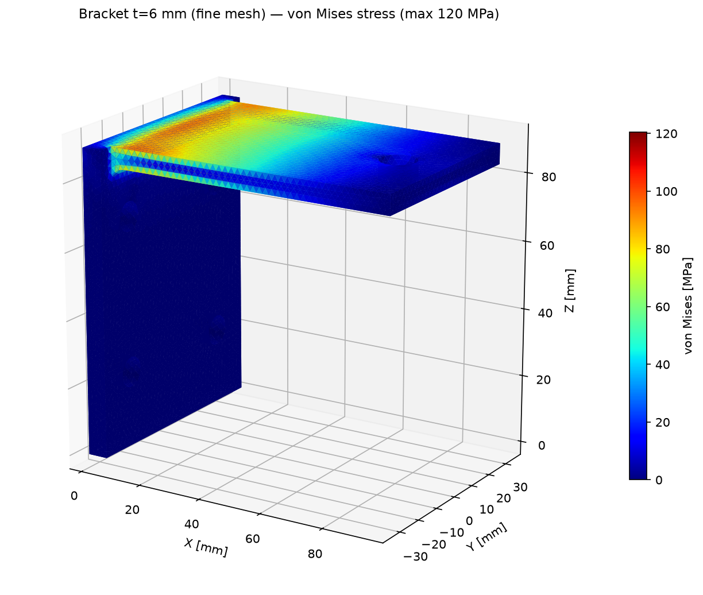
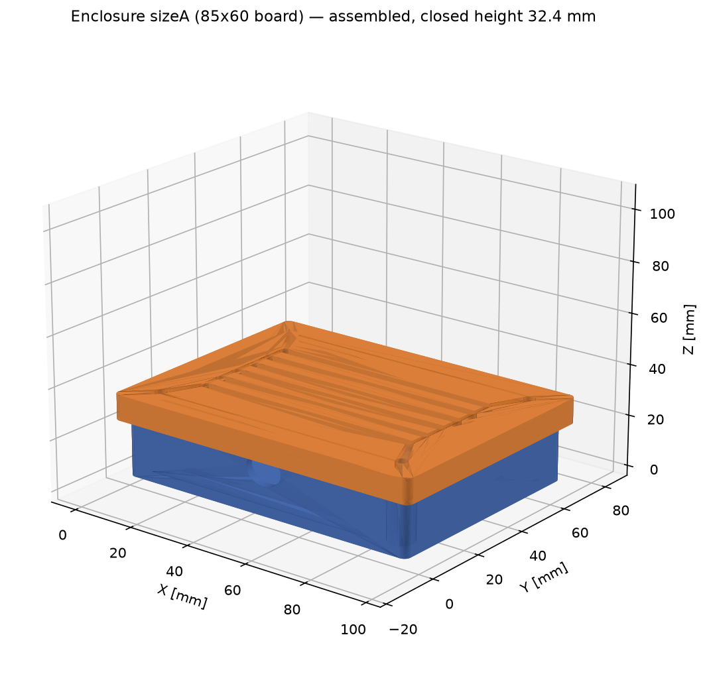
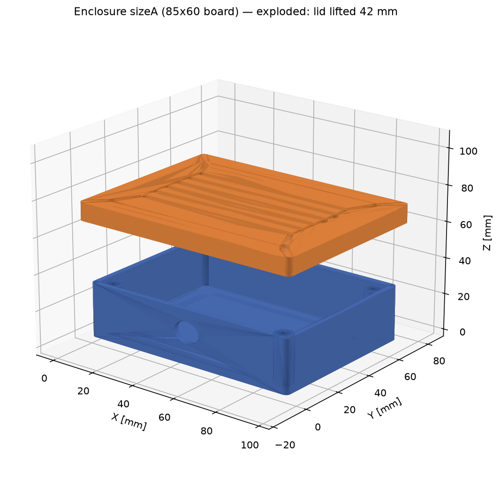

# CAD + FEA Portfolio — Prasad Dimba Anandappa

I build **parametric CAD models** (FreeCAD Python — change a number,
regenerate the part) and back them with **FEA simulation reports**
(CalculiX: stress, deflection, safety factor, mesh-convergence checked).
These two case studies are my public sample deliverables — every number
below is real solver output, and every file reproduces from the scripts
in this repo.

**Skills:** Parametric CAD · FreeCAD Python scripting · FEA (linear
static) · CalculiX / Gmsh · Design for 3D printing · Technical reporting

---

## Case Study 1 — Wall-mount bracket: parametric CAD + FEA

A steel cantilever bracket generated from one script, solved at two mesh
densities, then re-generated at a second thickness — a full design study.




Headline results (500 N tip load, S355 steel, fine mesh):

| | t = 6 mm | t = 9 mm |
|---|---|---|
| Max deflection | 0.412 mm | 0.117 mm |
| Max von Mises | 120 MPa | 57 MPa |
| Safety factor vs yield | 2.95 | 6.25 |
| Mass | 0.533 kg | 0.787 kg |

Reaction-force check: the fixed face returns +500.00 N against the 500 N
applied load in every run. Full method, assumptions, convergence table,
and limitations: [case-study-1-bracket/REPORT.md](case-study-1-bracket/REPORT.md)

## Case Study 2 — Parametric electronics enclosure

One script takes a PCB size and rebuilds a complete two-part enclosure —
base with standoff bosses and screw posts, vented lid, cable-gland hole —
in as many sizes as the product family needs.




Two sizes are built and verified (85×60 mm and 120×90 mm boards); all
STLs are watertight single solids whose mesh volumes match the CAD
volumes to <0.01 %. Details:
[case-study-2-enclosure/REPORT.md](case-study-2-enclosure/REPORT.md)

---

## Toolchain

FreeCAD 1.0.2 (headless Python) · Gmsh 4.12.1 · CalculiX 2.21 · Python
(NumPy / Matplotlib post-processing). All open-source; deliverables in
STEP/STL open anywhere.

## Reproduce

```bash
# Case 1
freecadcmd case-study-1-bracket/build_bracket.py -- --t 6 --out bracket_t6
python3    case-study-1-bracket/fea_run.py --step bracket_t6.step --job t6_fine --h 2.0
# Case 2
freecadcmd case-study-2-enclosure/build_enclosure.py -- --board 85x60 --comp 18 --out sizeA
```

## Scope & honesty note

These are workflow samples, not certified engineering. I offer modelling
and simulation analysis — no PE stamp, and no safety-critical, pressure,
lifting, or medical work. Assumptions behind every number are stated in
the case-study reports.

## License

MIT — see [LICENSE](LICENSE). The portfolio samples may be reused with
attribution.
