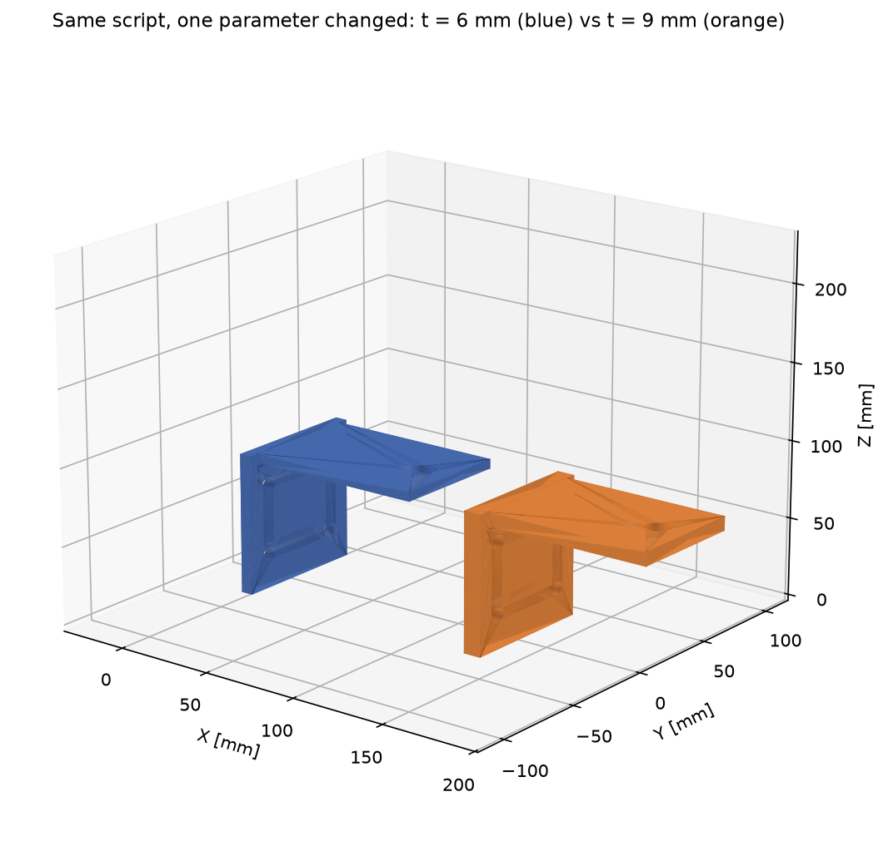
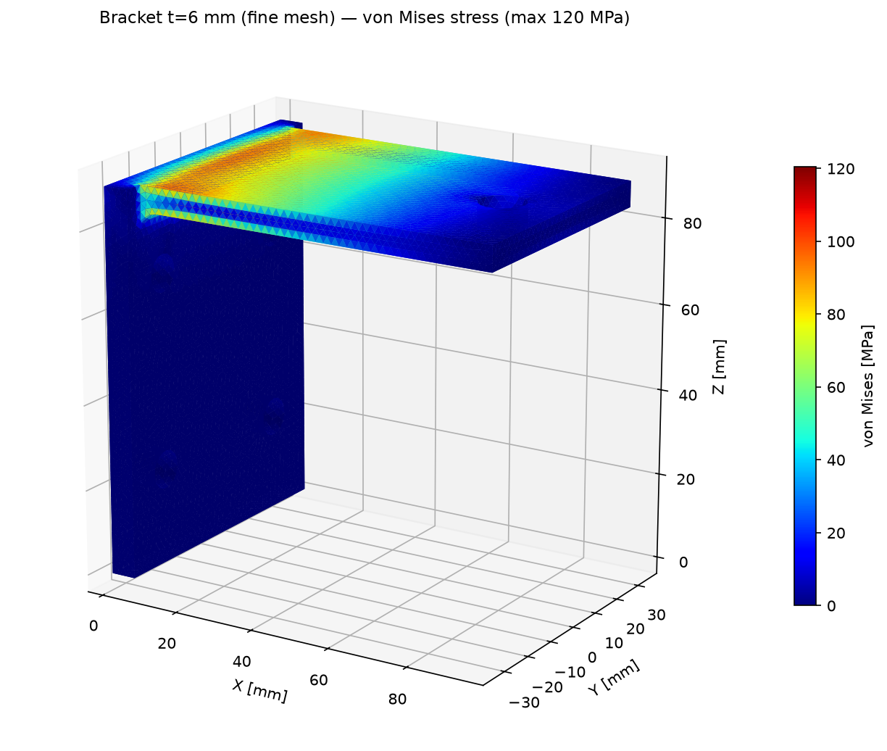
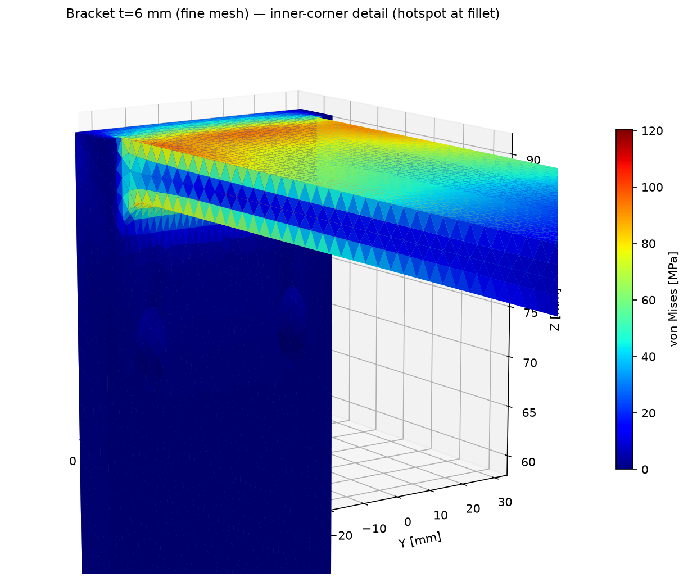
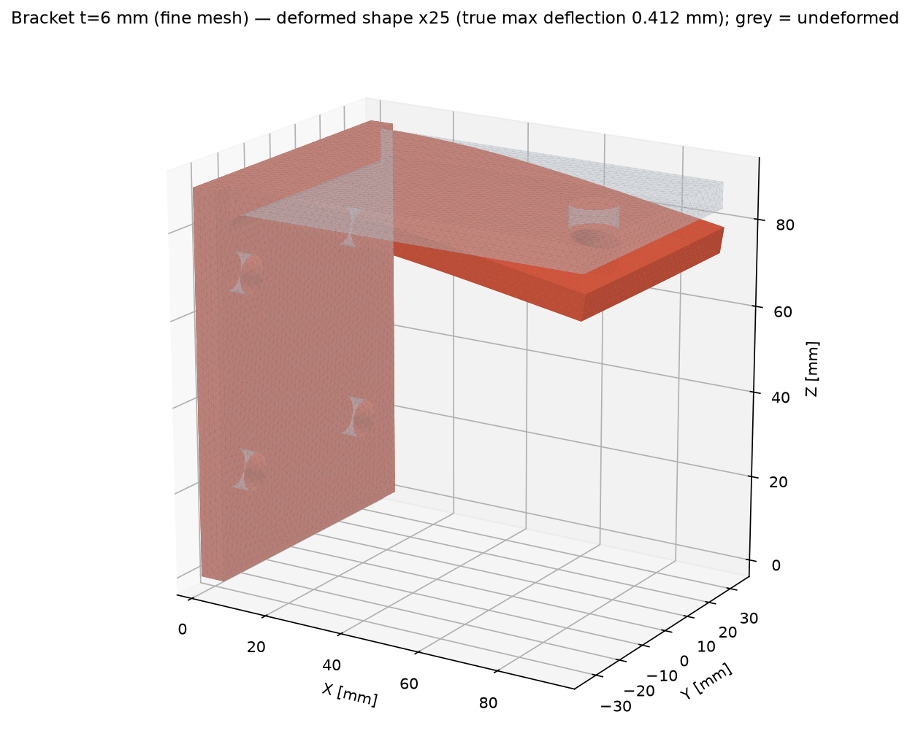

# Case Study 1 — Wall-Mount Cantilever Bracket
### Parametric CAD + linear static FEA (FreeCAD → Gmsh → CalculiX)

*A sample client deliverable: a steel wall-mount bracket, generated from a
single parametric script, stress-checked with FEA, then re-generated at a
second thickness to show the design trade-off — the same workflow I deliver
for paying clients.*



---

## 1. The part and the brief

A wall-mount cantilever bracket: a flat mounting plate bolts against a wall,
and a horizontal arm plate fused at its top carries a downward load near its
tip — the classic motor / shelf / sensor mount. Features:

- 4 × Ø9 mm mounting holes (M8 clearance) in the wall plate
- Ø11 mm pin hole near the arm tip
- 4 mm fillet on the loaded inner corner
- **One parameter — plate thickness `t` — drives both plates**, the hole
  positions, and the fillet placement. Change `t`, re-run, get a new bracket.

| Parameter | Variant A | Variant B |
|---|---|---|
| Plate thickness `t` | 6 mm | 9 mm |
| Mount plate (W × H) | 70 × 90 mm | 70 × 90 mm |
| Arm (length × width) | 95 × 60 mm | 95 × 60 mm |
| Volume | 67,949 mm³ | 100,200 mm³ |
| Mass (steel, 7,850 kg/m³) | 0.533 kg | 0.787 kg |

## 2. Method

| Step | Tool |
|---|---|
| Parametric solid | FreeCAD 1.0.2, headless Python (`build_bracket.py`) |
| Export | STEP (analysis) + STL (print/preview) |
| Mesh | Gmsh 4.12.1, 10-node tetrahedra (C3D10), two densities per variant |
| Solver | CalculiX 2.21, linear static |
| Post-processing | Custom Python (`.frd` parsing, nodal-averaged von Mises) |

**Material — structural steel S355:** E = 210 GPa, ν = 0.30, yield 355 MPa.

**Load case (stated assumptions):**

- The back face of the mounting plate (x = 0) is fully fixed — the bolted
  connection to a rigid wall is idealised as a clamped face.
- 500 N downward, distributed equally over the mesh nodes of the arm's
  top-face tip patch (x ≥ 70 mm) — 509–1,835 nodes depending on mesh.
- Linear elastic, small displacements. No fatigue, buckling, contact, or
  dynamic effects. Results are only as good as these assumptions.

**Verification built into the run:** the solver's reaction forces on the
fixed face were summed for every run — they return **+500.00 N in Z and
≈ 0.00 N in X/Y**, i.e. the model is in exact equilibrium with the applied
load, confirming the load path and boundary conditions are as intended.

## 3. Results



| Run | Mesh size | Nodes | Elements | Max deflection | Max von Mises | Safety factor vs 355 MPa |
|---|---|---|---|---|---|---|
| t=6, coarse | 4 mm | 14,438 | 7,201 | 0.408 mm | 105 MPa | 3.37 |
| **t=6, fine** | **2 mm** | **82,187** | **49,276** | **0.412 mm** | **120 MPa** | **2.95** |
| t=9, coarse | 4 mm | 18,554 | 10,076 | 0.116 mm | 49 MPa | 7.18 |
| **t=9, fine** | **2 mm** | **105,227** | **66,044** | **0.117 mm** | **57 MPa** | **6.25** |

- **Deflection is mesh-converged** (coarse→fine change: +0.8 % at t=6,
  +0.3 % at t=9) and peaks at the arm tip, as expected.
- **Peak stress sits at the inner-corner fillet** in every run — the
  physically correct hotspot. It is a genuine stress concentration, so the
  peak value is still mildly mesh-sensitive (+14 % coarse→fine); the
  fine-mesh value is the one used for the safety factor, and the coarse
  value is reported alongside it rather than hidden.
- A hand-check brackets the FEA: treating the arm as a simple cantilever
  beam gives ≈ 0.33 mm tip deflection and ≈ 106 MPa nominal root stress
  for t=6 — the FEA (0.41 mm, 120 MPa peak at a filleted concentration)
  sits sensibly just above the nominal values.




## 4. The parametric study — why one script matters

Same script, one number changed (`t`: 6 → 9 mm), everything re-generated
and re-solved automatically (fine-mesh values):

| Metric | t = 6 mm | t = 9 mm | Change |
|---|---|---|---|
| Max deflection | 0.412 mm | 0.117 mm | **−72 %** |
| Max von Mises | 120 MPa | 57 MPa | **−53 %** |
| Safety factor | 2.95 | 6.25 | ×2.1 |
| Mass | 0.533 kg | 0.787 kg | +48 % |

If the 500 N load is firm and a safety factor ≥ 3 is required, **t=6 mm is
marginal (2.95)** — the honest recommendation from this study is t=7–8 mm
as the weight/strength sweet spot, or t=9 mm if the extra 0.25 kg is free.
That recommendation — not just the plots — is what a client pays for.

## 5. Limitations (stated plainly)

- Linear static analysis only; the clamped-face idealisation is stiffer
  than a real 4-bolt joint, so real deflections will be somewhat higher.
- Peak stress is a local fillet value and remains slightly mesh-sensitive
  even at 49k elements; treat 105–120 MPa (t=6) as the honest range.
- This is a portfolio sample built to demonstrate workflow. It is **not**
  a certified engineering sign-off, and I do not offer stamped/PE work or
  analysis of safety-critical, pressure-bearing, lifting, or medical parts.

## 6. Files & reproduction

```
build_bracket.py     parametric FreeCAD script (edit P, or pass --t)
bracket_t6.step/.stl, bracket_t9.step/.stl
fea_run.py           Gmsh mesh -> CalculiX deck -> solve -> JSON summary
*_summary.json       full numeric record of each run (incl. reactions)
*_params.json        geometry record of each variant
contour_*.png, deformed_*.png, render_brackets_compare.png
```

```bash
freecadcmd build_bracket.py -- --t 6 --out bracket_t6
python3 fea_run.py --step bracket_t6.step --job t6_fine --h 2.0
```
