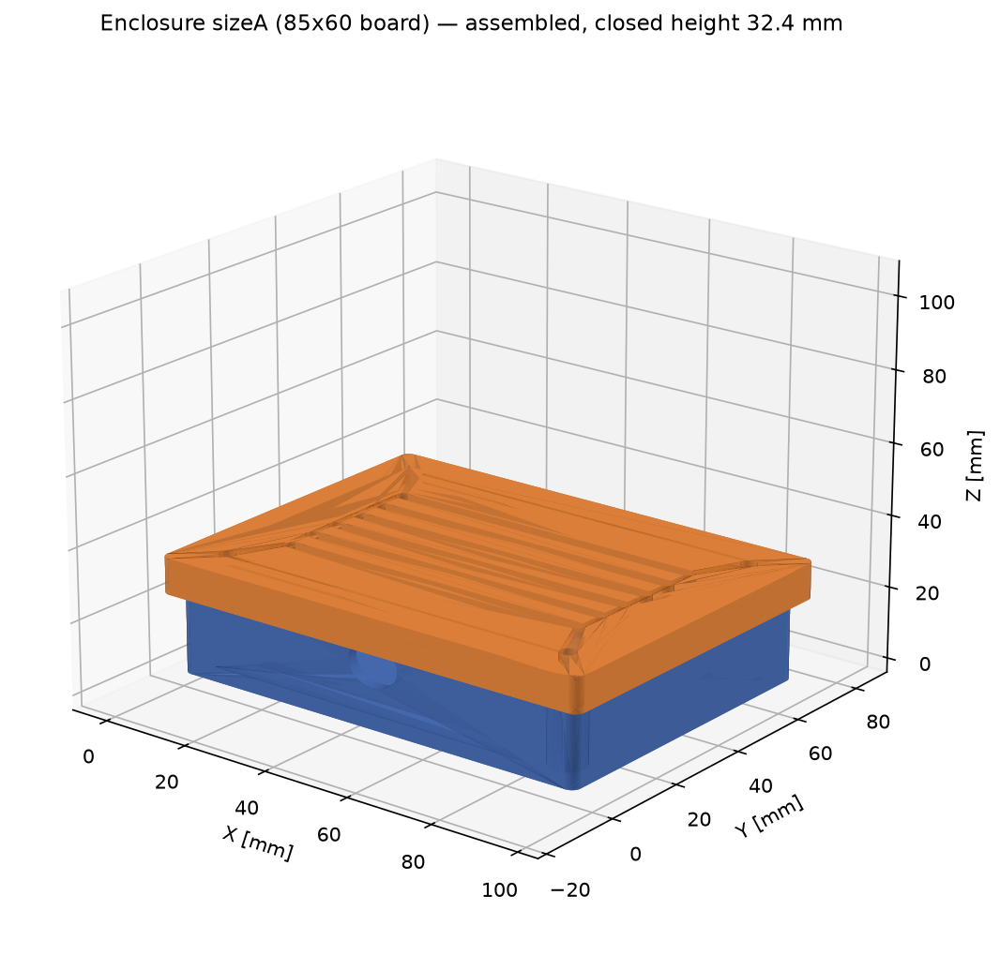
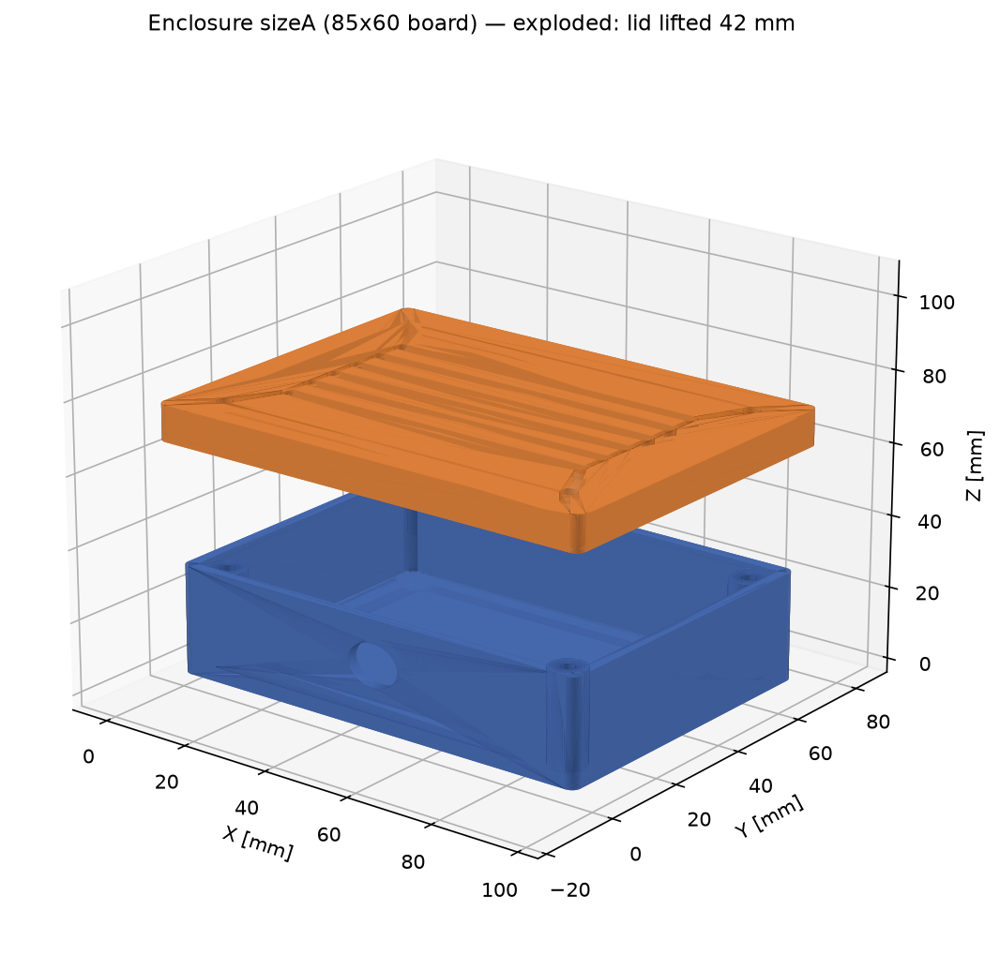
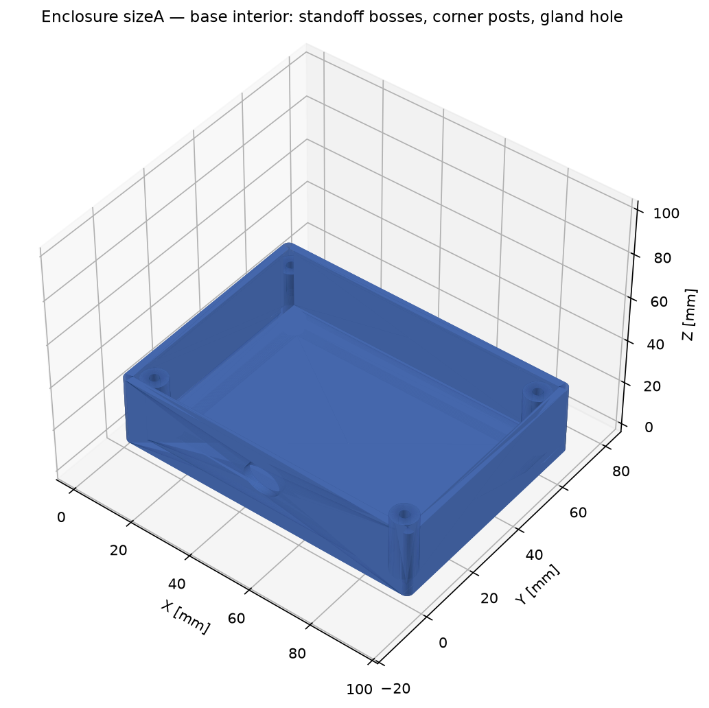
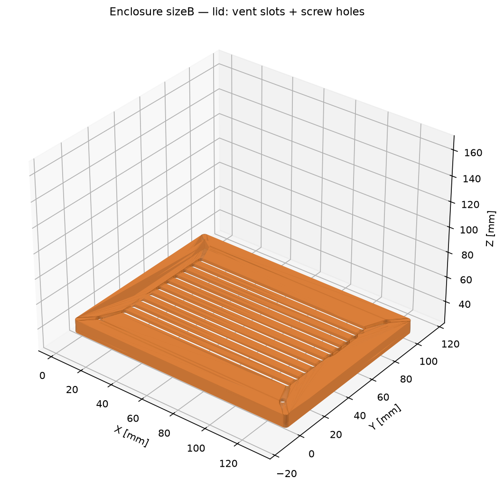
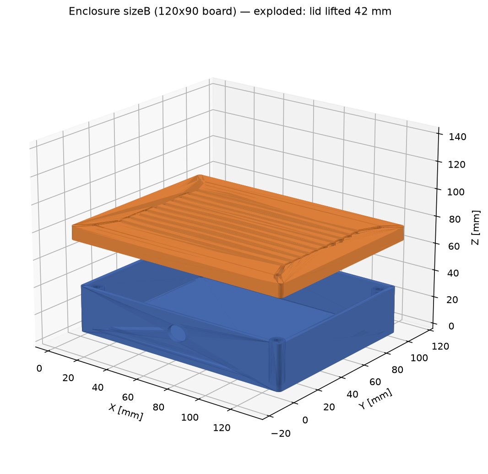

# Case Study 2 — Parametric Electronics Enclosure
### One script, any PCB size: base + lid, bosses, vents, print-ready STL

*A sample client deliverable: a two-part screw-together enclosure generated
entirely from parameters — tell the script your PCB size and component
height, and it rebuilds the whole enclosure around them.*




---

## 1. What the script builds

**Base tray**

- 2.4 mm walls and floor, cavity sized to the board + 3 mm clearance/side
- 4 × board standoff bosses (Ø6 mm, M3 pilot holes) at the PCB hole pattern
- 4 × corner posts (Ø8 mm, M3 pilot holes) that take the lid screws
- Ø12 mm cable-gland hole in the front wall
- 2 mm fillets on the outer vertical corners

**Lid**

- Top panel + 10 mm overlap skirt (0.4 mm/side sliding clearance)
- Vent-slot array in the top panel — **the row count is computed from the
  lid width**, so a bigger enclosure automatically gets more vents
- 4 × M3 clearance holes aligned exactly over the corner posts

## 2. Two sizes from one script

| | Size A | Size B |
|---|---|---|
| PCB (input parameter) | 85 × 60 mm | 120 × 90 mm |
| Component height (input) | 18 mm | 22 mm |
| Base outer (L × W × H) | 95.8 × 70.8 × 30.0 mm | 130.8 × 100.8 × 34.0 mm |
| Closed height (with lid) | 32.4 mm | 36.4 mm |
| Vent rows (auto) | 6 | 10 |
| Base volume | 42,411 mm³ | 71,532 mm³ |
| Lid volume | 21,639 mm³ | 35,633 mm³ |
| PLA mass, both parts (≈1.24 g/cm³) | ≈ 79 g | ≈ 133 g |





## 3. Print-readiness

- Every STL is the tessellation of a **single valid solid** — watertight,
  no self-intersections; mesh volumes reproduce the CAD volumes to <0.01 %
  (verified programmatically for all six files).
- 2.4 mm walls = 6 perimeters with a 0.4 mm nozzle — no thin-wall slicing
  surprises; vent slots (3 mm) and holes (Ø2.9 / Ø3.4 / Ø12) are all
  comfortably above FDM minimum feature sizes.
- Base prints floor-down with no supports (the gland hole is a short,
  easily bridged span); the lid prints top-panel-down, skirt up.

## 4. Honest notes

- Screw bosses and posts are sized for M3 self-tapping screws into printed
  plastic; pilot Ø2.9 mm suits PLA/PETG. For repeated assembly, ask for the
  heat-set-insert variant (boss Ø and pilot change — it's one parameter).
- The design is a functional enclosure, not an IP-rated or certified
  housing; no sealing, EMC, or flammability claims are made.

## 5. Files & reproduction

```
build_enclosure.py          parametric FreeCAD script
sizeA_base.step/.stl        sizeA_lid.step/.stl        sizeA_assembly.step
sizeB_base.step/.stl        sizeB_lid.step/.stl        sizeB_assembly.step
sizeA_params.json, sizeB_params.json
render_size*_*.png          assembled / exploded / base / lid views
```

```bash
freecadcmd build_enclosure.py -- --board 85x60  --comp 18 --out sizeA
freecadcmd build_enclosure.py -- --board 120x90 --comp 22 --out sizeB
# any other PCB:  --board <L>x<W> --comp <height above board>
```
